<div align="center">



<a href="https://git.io/typing-svg">
  
</a>

<br/>

<a href="https://www.linkedin.com/in/pedro-lucas-possidonio-11a94534a/"></a>
<a href="https://www.instagram.com/_cookiexr"></a>
<a href="mailto:pedropossid3@gmail.com"></a>
<a href="https://portifolio-sigma-three-46.vercel.app/"></a>
<a href="https://jarvis-hibrido.vercel.app/"></a>

<br/><br/>


</div>

---

### ◢ PILOT PROFILE

```yaml
pilot:          Pedro dos Santos
base:           Lins, Brazil
current_mission: Docs & Logistics @ MALED TRADING
training:       Software Engineering
side_quests:    [judo, exploring other programming languages]
ai_copilot:     Sexta-feira  # my local AI assistant
hq:             portifolio-sigma-three-46.vercel.app
```

### ◢ ACTIVE PROJECTS // MARK SERIES

| Suit | Project | What it does |
|:---:|---|---|
| **MK I** | [Sexta-feira](https://jarvis-hibrido.vercel.app/) | Local AI assistant with Portuguese voice, wakes up with two claps |
| **MK II** | Tripora | Travel website in PHP with 3D effects |
| **MK III** | [Gestão Pro](https://gestao-pro-kappa.vercel.app/) | Management web app |
| **MK IV** | PC Builder Simulator | Gamified PC-building simulator (team project) |

### ◢ ARSENAL

<p align="left">
  
</p>

### ◢ SYSTEM DIAGNOSTICS

<div align="center">
  
</div>

### ◢ COMBAT LOG

<div align="center">
  
</div>

<div align="center">

<sub><code>◢ SEXTA-FEIRA: session saved. See you next time, Pedro.</code></sub>

</div>
